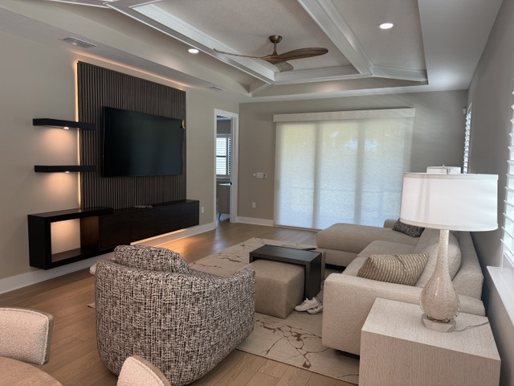

<section class="page-hero has-image">
    

      

      
<a href="/">Home</a> › <a href="/locations">Service Area</a> › North Port

      
Service Area

      <h1>Interior Designer in North Port, FL</h1>
      
North Port is one of Southwest Florida's fastest-growing cities, and its housing stock reflects that — mostly newer-construction homes where design decisions shape a blank canvas rather than update an old one.

      

        <a class="btn btn-primary" href="tel:+19414564136">Call (941) 456-4136</a>
        <a class="btn" href="/contact#consultation">Request a Consultation</a>
      

    

      

    

  </section>
  <section class="section band-white">
    

      <h2>Designing for North Port Homes</h2>
      
Because so much of North Port was built out in recent decades, homes here tend to share open floor plans and builder-grade finishes that are ready for a personal upgrade. That makes North Port a great fit for full-room design and color consultation work that adds character a production builder's palette doesn't offer.

      
Whether you're personalizing a newer North Port home or planning a larger renovation, we bring 20+ years of experience and 500+ completed projects to every job.

    

  </section>
  <section class="section band-sky">
    

      

        
Services in North Port

        <h2>How We Can Help</h2>
      

      

        <a class="btn" style="justify-content:center;" href="/services/interior-design">Interior Design</a>
        <a class="btn" style="justify-content:center;" href="/services/space-planning">Space Planning</a>
        <a class="btn" style="justify-content:center;" href="/services/color-consultation">Color Consultation</a>
        <a class="btn" style="justify-content:center;" href="/services/kitchen-bath-design">Kitchen &amp; Bath Design</a>
        <a class="btn" style="justify-content:center;" href="/services/new-construction-design">New Construction Design</a>
        <a class="btn btn-secondary" style="justify-content:center;" href="/services">View All Services</a>
      

    

  </section>
  <section class="section band-cream">
    

      

        
Nearby

        <h2>Other Areas We Serve</h2>
      

      

        <a class="btn" style="justify-content:center;" href="/locations/sarasota">Sarasota</a>
        <a class="btn" style="justify-content:center;" href="/locations/venice">Venice</a>
        <a class="btn" style="justify-content:center;" href="/locations/port-charlotte">Port Charlotte</a>
        <a class="btn" style="justify-content:center;" href="/locations/punta-gorda">Punta Gorda</a>
        <a class="btn" style="justify-content:center;" href="/locations/englewood">Englewood</a>
        <a class="btn" style="justify-content:center;" href="/locations/boca-grande">Boca Grande</a>
        <a class="btn btn-secondary" style="justify-content:center;" href="/locations">View All Areas</a>
      

    

  </section>
  <section class="section band-white">
    

      

        <h2>Interior Designer Near You in North Port</h2>
        
Most North Port homes are newer construction, which makes the design work less about undoing old decisions and more about making a new house feel like yours: a color palette with some warmth, furniture scaled to open rooms, window treatments for big sliders, and, for homes still being built, selections made alongside the builder.

        
Our studio is in Charlotte Harbor, a short drive down US 41. We, Holly and Lori, lead every project, with more than 20 years designing Southwest Florida homes and 500+ projects completed, and the initial consultation is free, a $250 value.

        <h3>Design services in North Port</h3>
        <ul>
          <li><a href="/services/new-construction-design">New construction design</a></li>
          <li><a href="/services/interior-design">Whole-home interior design</a></li>
          <li><a href="/services/space-planning">Space planning</a> for open floor plans</li>
          <li><a href="/services/color-consultation">Color consultation</a></li>
          <li><a href="/services/furniture-selection">Furniture ordering, delivery and placement</a></li>
        </ul>
        <h3>Nearby areas</h3>
        
We also design homes in <a href="/locations/port-charlotte">Port Charlotte</a>, <a href="/locations/punta-gorda">Punta Gorda</a> and <a href="/locations/venice">Venice and Nokomis</a>.

      

    

  </section>
  <section class="section cta-band band-navy" id="cta">
    

      

        
Let's Talk About Your North Port Home

        <h2>Ready to Get Started?</h2>
        
Call the studio, or send a quick note and we'll get back to you — either way, the first consultation is free.

      

      

        <a class="btn btn-primary" href="tel:+19414564136">
          <svg viewBox="0 0 24 24" fill="none" stroke="currentColor" stroke-width="2" stroke-linecap="round" stroke-linejoin="round" aria-hidden="true"><path d="M22 16.92v3a2 2 0 0 1-2.18 2 19.79 19.79 0 0 1-8.63-3.07 19.5 19.5 0 0 1-6-6 19.79 19.79 0 0 1-3.07-8.67A2 2 0 0 1 4.11 2h3a2 2 0 0 1 2 1.72c.127.96.362 1.903.7 2.81a2 2 0 0 1-.45 2.11L8.09 9.91a16 16 0 0 0 6 6l1.27-1.27a2 2 0 0 1 2.11-.45c.907.338 1.85.573 2.81.7A2 2 0 0 1 22 16.92z"></path></svg>
          Call (941) 456-4136
        </a>
        <a class="btn btn-ghost btn-lg" href="/contact#consultation">Request a Consultation</a>
      

    

  </section>
