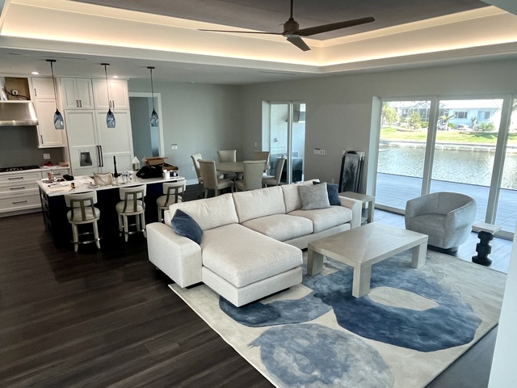

<section class="page-hero has-image">
    

      

      
<a href="/">Home</a> › <a href="/locations">Service Area</a> › Port Charlotte

      
Service Area

      <h1>Interior Designer in Port Charlotte, FL</h1>
      
Port Charlotte was laid out in the 1950s around an extensive canal system, and many of its homes are classic Florida ranch-style waterfront properties — we design with that layout and lifestyle in mind.

      

        <a class="btn btn-primary" href="tel:+19414564136">Call (941) 456-4136</a>
        <a class="btn" href="/contact#consultation">Request a Consultation</a>
      

    

      

    

  </section>
  <section class="section band-white">
    

      <h2>Designing for Port Charlotte Homes</h2>
      
Many Port Charlotte homes share the low-slung ranch profile and canal-front lot layout typical of the community's mid-century development, often updated over the decades since. That history makes thoughtful space planning and kitchen &amp; bath updates especially common requests here, since older layouts don't always match how families use a home today.

      
Whether you're updating a canal-front ranch or planning a larger renovation, we bring 20+ years of experience and 500+ completed projects to every Port Charlotte job.

    

  </section>
  <section class="section band-sky">
    

      

        
Services in Port Charlotte

        <h2>How We Can Help</h2>
      

      

        <a class="btn" style="justify-content:center;" href="/services/interior-design">Interior Design</a>
        <a class="btn" style="justify-content:center;" href="/services/space-planning">Space Planning</a>
        <a class="btn" style="justify-content:center;" href="/services/color-consultation">Color Consultation</a>
        <a class="btn" style="justify-content:center;" href="/services/kitchen-bath-design">Kitchen &amp; Bath Design</a>
        <a class="btn" style="justify-content:center;" href="/services/new-construction-design">New Construction Design</a>
        <a class="btn btn-secondary" style="justify-content:center;" href="/services">View All Services</a>
      

    

  </section>
  <section class="section band-cream">
    

      

        
Nearby

        <h2>Other Areas We Serve</h2>
      

      

        <a class="btn" style="justify-content:center;" href="/locations/sarasota">Sarasota</a>
        <a class="btn" style="justify-content:center;" href="/locations/venice">Venice</a>
        <a class="btn" style="justify-content:center;" href="/locations/north-port">North Port</a>
        <a class="btn" style="justify-content:center;" href="/locations/punta-gorda">Punta Gorda</a>
        <a class="btn" style="justify-content:center;" href="/locations/englewood">Englewood</a>
        <a class="btn" style="justify-content:center;" href="/locations/boca-grande">Boca Grande</a>
        <a class="btn btn-secondary" style="justify-content:center;" href="/locations">View All Areas</a>
      

    

  </section>
  <section class="section band-white">
    

      

        <h2>Port Charlotte Homes We Design For</h2>
        
Port Charlotte grew from the late 1950s as a planned community, laid out around long canals and streets of single-story ranch homes, and it is now home to more than 50,000 people. Many of those houses still have the closed kitchen, small baths and separate rooms they were built with, which is why space planning and kitchen and bath renovation are such common requests here.

        
Canal-front homes add the same questions we see across Charlotte Harbor: how to face the furniture toward the water, how to control glare through big sliders, and which fabrics, rugs and finishes stand up to sun and humidity. Newer homes and condos in Port Charlotte bring the opposite brief: a blank, open floor plan that needs warmth, color and a layout that works.

        <h2>Just Across the River from Our Studio</h2>
        
Our studio is in Charlotte Harbor, a few minutes from most of Port Charlotte. That makes it easy to meet in your home for the consultation, come back to measure, and visit the studio to see your selections laid out as real samples.

        <blockquote>
We hired Lori to help us with the past two homes we built. She is very knowledgeable, creative  and fun to work with. I took my ideas and inspirations to her and she helped facilitate my dreams into reality! She was awesome to work with!
</blockquote>
        
<strong>Rosi B.</strong>, Google review, October 2026

        <h2>Port Charlotte Interior Design Questions</h2>
        

          

            
Can you help open up an older Port Charlotte floor plan?

            
Yes. One team handles design and renovation, so we can plan a more open layout, a new kitchen or an updated bath and see it through to the final install.

          

          

            
Do you work on canal-front homes in Port Charlotte?

            
Yes. We design canal-front homes across Port Charlotte, with layouts, window treatments and fabrics chosen for the view, the sun and the humidity.

          

          

            
How far is your studio from Port Charlotte?

            
Our studio is in Charlotte Harbor, a few minutes from most of Port Charlotte. Studio visits are by appointment, and the first consultation happens in your home.

          

        

        <h2>Interior Designer Near You in Port Charlotte</h2>
        
If you are searching for an interior designer in Port Charlotte, we are an owner-led studio with more than 20 years in Southwest Florida and 500+ projects completed. We, Holly and Lori, lead every project, and one team handles design and renovation from the first layout to the final install.

        
The initial consultation is free, a $250 value, and we handle furniture ordering, receiving, delivery and placement, which helps if you split the year between Port Charlotte and somewhere else.

        <h3>Design services in Port Charlotte</h3>
        <ul>
          <li><a href="/services/interior-design">Interior design</a> for whole homes and single rooms</li>
          <li><a href="/services/space-planning">Space planning</a> for ranch-style layouts</li>
          <li><a href="/services/kitchen-bath-design">Kitchen and bath design and renovation</a></li>
          <li><a href="/services/color-consultation">Color consultation</a></li>
          <li><a href="/services/window-treatments">Window treatments</a> and <a href="/services/custom-fabrics">custom fabrics</a></li>
          <li><a href="/services/furniture-selection">Furniture</a>, <a href="/services/rugs-fabrics">rugs</a> and <a href="/services/art-accessories">styling</a></li>
        </ul>
        <h3>Nearby areas</h3>
        
We also design homes in neighboring <a href="/locations/punta-gorda">Punta Gorda</a> and Charlotte Harbor, and north in <a href="/locations/north-port">North Port</a>.

      

    

  </section>
  <section class="section cta-band band-navy" id="cta">
    

      

        
Let's Talk About Your Port Charlotte Home

        <h2>Ready to Get Started?</h2>
        
Call the studio, or send a quick note and we'll get back to you — either way, the first consultation is free.

      

      

        <a class="btn btn-primary" href="tel:+19414564136">
          <svg viewBox="0 0 24 24" fill="none" stroke="currentColor" stroke-width="2" stroke-linecap="round" stroke-linejoin="round" aria-hidden="true"><path d="M22 16.92v3a2 2 0 0 1-2.18 2 19.79 19.79 0 0 1-8.63-3.07 19.5 19.5 0 0 1-6-6 19.79 19.79 0 0 1-3.07-8.67A2 2 0 0 1 4.11 2h3a2 2 0 0 1 2 1.72c.127.96.362 1.903.7 2.81a2 2 0 0 1-.45 2.11L8.09 9.91a16 16 0 0 0 6 6l1.27-1.27a2 2 0 0 1 2.11-.45c.907.338 1.85.573 2.81.7A2 2 0 0 1 22 16.92z"></path></svg>
          Call (941) 456-4136
        </a>
        <a class="btn btn-ghost btn-lg" href="/contact#consultation">Request a Consultation</a>
      

    

  </section>
