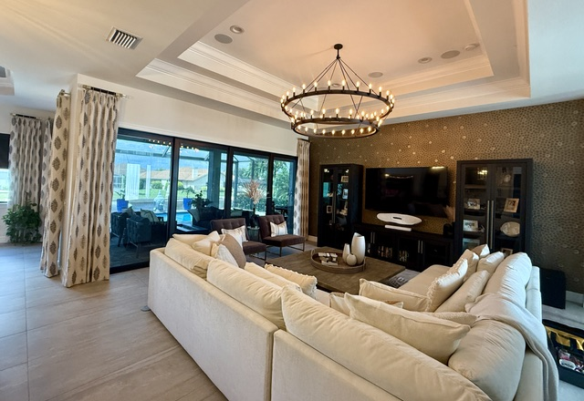

<section class="page-hero has-image">
    

      

      
<a href="/">Home</a> › <a href="/locations">Service Area</a> › Punta Gorda

      
Service Area

      <h1>Interior Designer in Punta Gorda, FL</h1>
      
Punta Gorda pairs a walkable historic downtown on Charlotte Harbor with newer waterfront neighborhoods — two very different design conversations, and we're comfortable having both.

      

        <a class="btn btn-primary" href="tel:+19414771313">Call (941) 477-1313</a>
        <a class="btn" href="/contact#consultation">Request a Consultation</a>
      

    

      

    

  </section>
  <section class="section band-white">
    

      <h2>Designing for Punta Gorda Homes</h2>
      
Historic homes near downtown Punta Gorda and Fishermen's Village often call for design that respects an older Florida character, while the newer harbor-front and canal communities further out call for a more contemporary coastal approach. Either way, the harbor is never far from the conversation.

      
Whether you're refreshing a historic downtown home or planning a renovation on the water, we bring 20+ years of experience and 500+ completed projects to every Punta Gorda job.

    

  </section>
  <section class="section band-sky">
    

      

        
Services in Punta Gorda

        <h2>How We Can Help</h2>
      

      

        <a class="btn" style="justify-content:center;" href="/services/interior-design">Interior Design</a>
        <a class="btn" style="justify-content:center;" href="/services/space-planning">Space Planning</a>
        <a class="btn" style="justify-content:center;" href="/services/color-consultation">Color Consultation</a>
        <a class="btn" style="justify-content:center;" href="/services/kitchen-bath-design">Kitchen &amp; Bath Design</a>
        <a class="btn" style="justify-content:center;" href="/services/new-construction-design">New Construction Design</a>
        <a class="btn btn-secondary" style="justify-content:center;" href="/services">View All Services</a>
      

    

  </section>
  <section class="section band-cream">
    

      

        
Nearby

        <h2>Other Areas We Serve</h2>
      

      

        <a class="btn" style="justify-content:center;" href="/locations/sarasota">Sarasota</a>
        <a class="btn" style="justify-content:center;" href="/locations/venice">Venice</a>
        <a class="btn" style="justify-content:center;" href="/locations/north-port">North Port</a>
        <a class="btn" style="justify-content:center;" href="/locations/port-charlotte">Port Charlotte</a>
        <a class="btn" style="justify-content:center;" href="/locations/englewood">Englewood</a>
        <a class="btn" style="justify-content:center;" href="/locations/boca-grande">Boca Grande</a>
        <a class="btn btn-secondary" style="justify-content:center;" href="/locations">View All Areas</a>
      

    

  </section>
  <section class="section band-white">
    

      

        <h2>Punta Gorda Neighborhoods We Design For</h2>
        
Punta Gorda is a city of about 20,000 people where the Peace River meets Charlotte Harbor, and our studio sits just across the Peace River in Charlotte Harbor. Much of the downtown was rebuilt after Hurricane Charley in 2004, so homes near the Harborwalk and Fishermen's Village range from restored older Florida houses to newer builds, and each calls for a different design conversation.

        
Punta Gorda Isles and Burnt Store Isles are canal communities where nearly every home faces the water. Design there starts with the view: furniture that does not turn its back on the lanai, window treatments that cut afternoon glare without hiding the canal, and fabrics that stand up to sun and salt air. South along Burnt Store Road, newer communities bring new-build decisions, where we work alongside the builder from the first selections.

        
Many Punta Gorda owners are here for the season, so we often furnish and finish a home before its owners arrive, handling the ordering, receiving, delivery and placement.

        <h2>A Punta Gorda Client in Their Own Words</h2>
        <blockquote>
Lori Brunderman helped us design a beautiful home in Punta Gorda.  Our house had the WOW factor times ten.  She has incredible talent, listens to what you are looking for and makes it happen.  Our house was modern but still had that homey feel.  Everyone who came to visit was blown away!
</blockquote>
        
<strong>William B.</strong>, Google review, October 2026

        <h2>Punta Gorda Interior Design Questions</h2>
        

          

            
Do you design homes in Punta Gorda Isles and Burnt Store Isles?

            
Yes. We design homes throughout Punta Gorda, including Punta Gorda Isles, Burnt Store Isles, the Burnt Store Road communities and the historic downtown, and our studio in Charlotte Harbor is only minutes away.

          

          

            
Can you get a seasonal home ready before we arrive?

            
Yes. We handle furniture ordering, receiving, delivery and placement, so a Punta Gorda home can be furnished and finished before you come down for the season.

          

          

            
How do we get started?

            
Call (941) 477-1313 or send the consultation form. The initial consultation is free, a $250 value, and it takes place in your home so we can see the light, the layout and the view.

          

        

        <h2>Interior Designer Near You in Punta Gorda</h2>
        
If you are looking for an interior designer in Punta Gorda, we are about as local as it gets. We, Holly and Lori, lead every project ourselves, with more than 20 years designing Southwest Florida homes and 500+ projects completed. One team handles both design and renovation, so a project can go from a furniture layout to a kitchen remodel without changing hands.

        
Every project starts with an in-home consultation, and the initial consultation is free, a $250 value. You will see your selections as real samples laid out in our studio, and we can draw on to-the-trade fabric and furniture lines sold only through designers.

        <h3>Design services in Punta Gorda</h3>
        <ul>
          <li><a href="/services/interior-design">Whole-home and single-room interior design</a></li>
          <li><a href="/services/kitchen-bath-design">Kitchen and bath design and renovation</a></li>
          <li><a href="/services/new-construction-design">New construction design</a> for Burnt Store and beyond</li>
          <li><a href="/services/window-treatments">Window treatments</a> for canal-front glass</li>
          <li><a href="/services/furniture-selection">Indoor and lanai furniture</a></li>
          <li><a href="/services/color-consultation">Color consultation</a></li>
        </ul>
        <h3>Nearby areas</h3>
        
Just across the river we also design homes in <a href="/locations/port-charlotte">Port Charlotte</a> and Charlotte Harbor, and down the coast in <a href="/locations/englewood">Englewood</a> and <a href="/locations/boca-grande">Boca Grande</a>.

      

    

  </section>
  <section class="section cta-band band-navy" id="cta">
    

      

        
Let's Talk About Your Punta Gorda Home

        <h2>Ready to Get Started?</h2>
        
Call the studio, or send a quick note and we'll get back to you — either way, the first consultation is free.

      

      

        <a class="btn btn-primary" href="tel:+19414771313">
          <svg viewBox="0 0 24 24" fill="none" stroke="currentColor" stroke-width="2" stroke-linecap="round" stroke-linejoin="round" aria-hidden="true"><path d="M22 16.92v3a2 2 0 0 1-2.18 2 19.79 19.79 0 0 1-8.63-3.07 19.5 19.5 0 0 1-6-6 19.79 19.79 0 0 1-3.07-8.67A2 2 0 0 1 4.11 2h3a2 2 0 0 1 2 1.72c.127.96.362 1.903.7 2.81a2 2 0 0 1-.45 2.11L8.09 9.91a16 16 0 0 0 6 6l1.27-1.27a2 2 0 0 1 2.11-.45c.907.338 1.85.573 2.81.7A2 2 0 0 1 22 16.92z"></path></svg>
          Call (941) 477-1313
        </a>
        <a class="btn btn-ghost btn-lg" href="/contact#consultation">Request a Consultation</a>
      

    

  </section>
