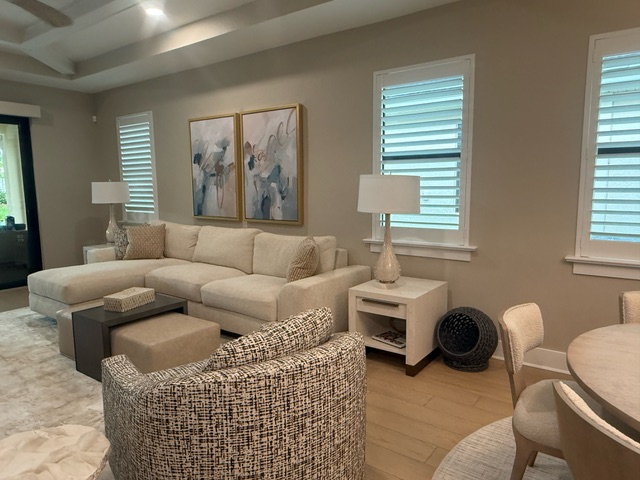

<section class="page-hero has-image">
    

      

      
<a href="/">Home</a> › <a href="/locations">Service Area</a> › Venice

      
Service Area

      <h1>Interior Designer in Venice &amp; Nokomis, FL</h1>
      
Venice was master-planned in the 1920s with a distinct Northern Italian Renaissance character, and its historic homes still carry that character today — we design with it, not against it.

      

        <a class="btn btn-primary" href="tel:+19414564136">Call (941) 456-4136</a>
        <a class="btn" href="/contact#consultation">Request a Consultation</a>
      

    

      

    

  </section>
  <section class="section band-white">
    

      <h2>Designing for Venice Homes</h2>
      
Venice Island's historic homes sit close to Mediterranean and Northern Italian Renaissance architectural roots, while newer neighborhoods further from downtown lean toward more contemporary coastal styles. Interior work here often means honoring an existing architectural character rather than overriding it — especially in and around the historic district.

      
Whether you're updating a home near the historic downtown or planning a full renovation in a newer Venice neighborhood, we bring 20+ years of experience and 500+ completed projects to every job.

    

  </section>
  <section class="section band-sky">
    

      

        
Services in Venice

        <h2>How We Can Help</h2>
      

      

        <a class="btn" style="justify-content:center;" href="/services/interior-design">Interior Design</a>
        <a class="btn" style="justify-content:center;" href="/services/space-planning">Space Planning</a>
        <a class="btn" style="justify-content:center;" href="/services/color-consultation">Color Consultation</a>
        <a class="btn" style="justify-content:center;" href="/services/kitchen-bath-design">Kitchen &amp; Bath Design</a>
        <a class="btn" style="justify-content:center;" href="/services/new-construction-design">New Construction Design</a>
        <a class="btn btn-secondary" style="justify-content:center;" href="/services">View All Services</a>
      

    

  </section>
  <section class="section band-cream">
    

      

        
Nearby

        <h2>Other Areas We Serve</h2>
      

      

        <a class="btn" style="justify-content:center;" href="/locations/sarasota">Sarasota</a>
        <a class="btn" style="justify-content:center;" href="/locations/north-port">North Port</a>
        <a class="btn" style="justify-content:center;" href="/locations/port-charlotte">Port Charlotte</a>
        <a class="btn" style="justify-content:center;" href="/locations/punta-gorda">Punta Gorda</a>
        <a class="btn" style="justify-content:center;" href="/locations/englewood">Englewood</a>
        <a class="btn" style="justify-content:center;" href="/locations/boca-grande">Boca Grande</a>
        <a class="btn btn-secondary" style="justify-content:center;" href="/locations">View All Areas</a>
      

    

  </section>
  <section class="section band-white">
    

      

        <h2>Venice Island, Newer Venice &amp; Nokomis</h2>
        
Venice was planned in the 1920s by John Nolen, and Venice Island still carries that Mediterranean and Northern Italian character. Interior work on the island usually means designing with the architecture: plaster, arches and tile that deserve furnishings and colors that respect them. East of the island, newer neighborhoods lean contemporary coastal, with open plans and lanais that need a different approach.

        
Just north, Nokomis pairs quiet, established neighborhoods along Dona and Roberts Bays with some of the area's most striking waterfront homes out on Casey Key. Homes range from mid-century ranches ready for an update to newer builds with walls of glass facing the water, so the brief changes from house to house: opening up a closed floor plan in one, choosing finishes and furnishings that do not compete with the view in the next.

        <h2>An Interior Design Studio for Venice &amp; Nokomis Homes</h2>
        
Our interior design studio is in Charlotte Harbor, south of Venice along US 41, and we design and renovate homes across Sarasota County. We, Holly and Lori, lead every project, with more than 20 years designing Southwest Florida homes and 500+ projects completed.

        
The initial consultation is free, a $250 value, and it takes place in your home. You see your selections as real samples laid out in our studio, and we handle furniture ordering, receiving, delivery and placement, which matters for the many Venice and Nokomis owners who are here for the season.

        <h3>Design services in Venice and Nokomis</h3>
        <ul>
          <li><a href="/services/interior-design">Interior design</a> for historic and newer homes</li>
          <li><a href="/services/kitchen-bath-design">Kitchen and bath design and renovation</a></li>
          <li><a href="/services/color-consultation">Color consultation</a> for Florida light</li>
          <li><a href="/services/window-treatments">Window treatments</a> for waterfront glass</li>
          <li><a href="/services/furniture-selection">Indoor and lanai furniture</a></li>
          <li><a href="/services/art-accessories">Art and final styling</a></li>
        </ul>
        <h3>Nearby areas</h3>
        
We also design homes north in <a href="/locations/sarasota">Sarasota</a> and south in <a href="/locations/englewood">Englewood</a> and <a href="/locations/north-port">North Port</a>.

      

    

  </section>
  <section class="section cta-band band-navy" id="cta">
    

      

        
Let's Talk About Your Venice Home

        <h2>Ready to Get Started?</h2>
        
Call the studio, or send a quick note and we'll get back to you — either way, the first consultation is free.

      

      

        <a class="btn btn-primary" href="tel:+19414564136">
          <svg viewBox="0 0 24 24" fill="none" stroke="currentColor" stroke-width="2" stroke-linecap="round" stroke-linejoin="round" aria-hidden="true"><path d="M22 16.92v3a2 2 0 0 1-2.18 2 19.79 19.79 0 0 1-8.63-3.07 19.5 19.5 0 0 1-6-6 19.79 19.79 0 0 1-3.07-8.67A2 2 0 0 1 4.11 2h3a2 2 0 0 1 2 1.72c.127.96.362 1.903.7 2.81a2 2 0 0 1-.45 2.11L8.09 9.91a16 16 0 0 0 6 6l1.27-1.27a2 2 0 0 1 2.11-.45c.907.338 1.85.573 2.81.7A2 2 0 0 1 22 16.92z"></path></svg>
          Call (941) 456-4136
        </a>
        <a class="btn btn-ghost btn-lg" href="/contact#consultation">Request a Consultation</a>
      

    

  </section>
