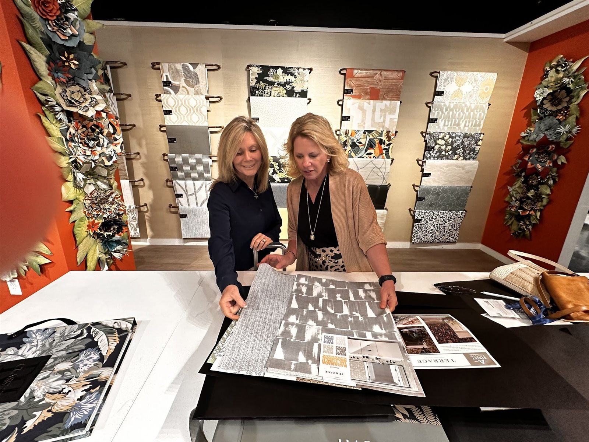
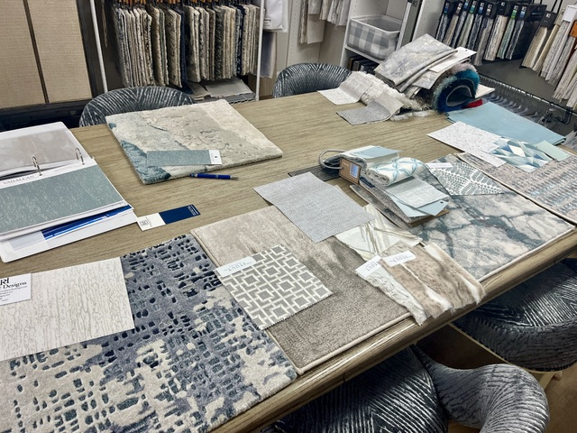

<section class="page-hero has-image">
    

      

      
<a href="/">Home</a> › Contact

      
Contact

      <h1>Contact Our Punta Gorda Interior Design Studio</h1>
      
Send the form, call, or email — the initial consultation is complimentary, a $250 value. We meet by appointment at your home or at the studio in Charlotte Harbor.

      

      

    

  </section>
  <section class="section form-section band-white" id="consultation">
    

      <form class="quote-form" name="consultation-request" method="POST" action="/thank-you" data-netlify="true" netlify-honeypot="bot-field" novalidate="">
        <input type="hidden" name="form-name" value="consultation-request">
        <input type="hidden" name="page" value="">
        <input type="hidden" name="first_page" value="">
        <input type="hidden" name="referrer" value="">
        
<label>Leave this field blank: <input name="bot-field" tabindex="-1" autocomplete="off"></label>

        
Free Consultation · $250 Value

        <h2 style="margin-bottom:1.25rem;">Request a Consultation</h2>
        
<small>Step 1 of 4</small>

        

          Your Name *
          <input type="text" name="name" placeholder="Full Name" required="" autocomplete="name">
          How Can We Reach You? *
          
Phone or email — whichever you prefer.

          

            <input type="tel" name="phone" placeholder="Phone" autocomplete="tel" aria-label="Phone">
            <input type="email" name="email" placeholder="Email" autocomplete="email" aria-label="Email">
          

          <!-- SMS consent for Interior Motives Design's own 10DLC campaign: unchecked, optional, separate from any terms, names the business and the message types, links to the policy pages. Lands in the Netlify submission as sms_consent=yes. -->
          <label class="consent-row"><input type="checkbox" name="sms_consent" value="yes"> By providing my phone number and checking this box, I agree to receive SMS customer care messages from Interior Motives Design: callback confirmations, follow-ups on my request, appointment reminders and a review request after a completed project. Message frequency may vary. Standard message and data rates may apply. Reply STOP to opt out, HELP for help. We will not share mobile information with third parties for promotional or marketing purposes. Consent is not a condition of purchase. <a href="/privacy">Privacy Policy</a> and <a href="/terms">Terms</a>.</label>
          
Tell us who you are and a few more questions will appear.

        

        

          Where Is the Project?
          <select name="service-area">
            <option value="" disabled="" selected="">City / Service Area</option>
            <option>Charlotte Harbor</option>
            <option>Punta Gorda</option>
            <option>Port Charlotte</option>
            <option>North Port</option>
            <option>Venice</option>
            <option>Sarasota</option>
            <option>Cape Coral</option>
            <option>Englewood</option>
            <option>Boca Grande</option>
            <option>Nokomis</option>
            <option>Other</option>
          </select>
          How Did You Hear About Us?
          <select name="heard_about" aria-label="How did you hear about us?">
            <option value="" selected="">Choose one (optional)</option>
            <option>Google search</option>
            <option>Google Maps / our Google listing</option>
            <option>Facebook</option>
            <option>Instagram</option>
            <option>A friend, family member or past client</option>
            <option>A builder, realtor or trade partner</option>
            <option>Saw our work in someone's home</option>
            <option>Other</option>
          </select>
          What Can We Help With?
          

            <label class="check-item"><input type="checkbox" name="service[]" value="Interior Design"> Interior Design</label>
            <label class="check-item"><input type="checkbox" name="service[]" value="Space Planning"> Space Planning</label>
            <label class="check-item"><input type="checkbox" name="service[]" value="Color Consultation"> Color Consultation</label>
            <label class="check-item"><input type="checkbox" name="service[]" value="Kitchen &amp; Bath Design"> Kitchen &amp; Bath Design</label>
            <label class="check-item"><input type="checkbox" name="service[]" value="New Construction Design"> New Construction Design</label>
            <label class="check-item"><input type="checkbox" name="service[]" value="Wallpaper &amp; Window Treatments"> Wallpaper &amp; Window Treatments</label>
            <label class="check-item"><input type="checkbox" name="service[]" value="Furniture &amp; Decor"> Furniture &amp; Decor</label>
            <label class="check-item"><input type="checkbox" name="service[]" value="Other"> Other</label>
          

          
Pick a city and at least one service to continue.

        

        

          When Would You Like to Start?
          

            <label class="radio-item"><input type="radio" name="timing" value="Timing is flexible"> Timing is Flexible</label>
            <label class="radio-item"><input type="radio" name="timing" value="Within 1 month"> Within 1 Month</label>
            <label class="radio-item"><input type="radio" name="timing" value="1 to 3 months"> 1–3 Months</label>
            <label class="radio-item"><input type="radio" name="timing" value="More than 3 months"> More Than 3 Months</label>
          

          Project Status
          

            <label class="radio-item"><input type="radio" name="status" value="Ready to book a consultation"> Ready to Book</label>
            <label class="radio-item"><input type="radio" name="status" value="Just exploring ideas"> Just Exploring Ideas</label>
          

          
Almost there — one last question.

        

        

          Tell Us About Your Project
          <textarea name="message" id="message" placeholder="Rooms involved, the style you're drawn to, a rough budget range, anything else we should know."></textarea>
        

        <button type="submit" class="btn btn-primary btn-lg">Send My Request</button>
        
We'll only use your details to follow up about your project.

      </form>
      <aside class="form-aside">
        

          
Let's Chat

          <h2>Let's Get in Touch</h2>
          
Prefer to talk? We're happy to walk through your project over the phone — no obligation, no pressure.

          <ul class="contact-list">
            <li>
              <svg viewBox="0 0 24 24" fill="none" stroke="currentColor" stroke-linecap="round" stroke-linejoin="round" aria-hidden="true"><path d="M22 16.92v3a2 2 0 0 1-2.18 2 19.79 19.79 0 0 1-8.63-3.07 19.5 19.5 0 0 1-6-6 19.79 19.79 0 0 1-3.07-8.67A2 2 0 0 1 4.11 2h3a2 2 0 0 1 2 1.72c.127.96.362 1.903.7 2.81a2 2 0 0 1-.45 2.11L8.09 9.91a16 16 0 0 0 6 6l1.27-1.27a2 2 0 0 1 2.11-.45c.907.338 1.85.573 2.81.7A2 2 0 0 1 22 16.92z"></path></svg>
              <a href="tel:+19414564136">(941) 456-4136</a><small>Lori · by appointment</small>
            </li>
            <li>
              <svg viewBox="0 0 24 24" fill="none" stroke="currentColor" stroke-linecap="round" stroke-linejoin="round" aria-hidden="true"><path d="M22 16.92v3a2 2 0 0 1-2.18 2 19.79 19.79 0 0 1-8.63-3.07 19.5 19.5 0 0 1-6-6 19.79 19.79 0 0 1-3.07-8.67A2 2 0 0 1 4.11 2h3a2 2 0 0 1 2 1.72c.127.96.362 1.903.7 2.81a2 2 0 0 1-.45 2.11L8.09 9.91a16 16 0 0 0 6 6l1.27-1.27a2 2 0 0 1 2.11-.45c.907.338 1.85.573 2.81.7A2 2 0 0 1 22 16.92z"></path></svg>
              <a href="tel:+17276382381">(727) 638-2381</a><small>Holly · by appointment</small>
            </li>
            <li>
              <svg viewBox="0 0 24 24" fill="none" stroke="currentColor" stroke-linecap="round" stroke-linejoin="round" aria-hidden="true"><path d="M22 6l-10 7L2 6"></path><rect x="2" y="4" width="20" height="16" rx="2"></rect></svg>
              <a href="mailto:Info@InteriorMotives1.com">Info@InteriorMotives1.com</a>
            </li>
            <li>
              <svg viewBox="0 0 24 24" fill="none" stroke="currentColor" stroke-linecap="round" stroke-linejoin="round" aria-hidden="true"><path d="M21 10c0 6-9 12-9 12s-9-6-9-12a9 9 0 0 1 18 0z"></path><circle cx="12" cy="10" r="3"></circle></svg>
              4288 Pinnacle St, Punta Gorda, FL 33980<small>Our Charlotte Harbor studio · visits by appointment</small>
            </li>
          </ul>
        

        

          
        

      </aside>
    

  </section>
  <section class="section band-sky">
    

      

        
Service Area

        <h2>Where We Work</h2>
      

      

        <a class="btn" href="/locations/sarasota">Sarasota</a>
        <a class="btn" href="/locations/venice">Venice</a>
        <a class="btn" href="/locations/north-port">North Port</a>
        <a class="btn" href="/locations/port-charlotte">Port Charlotte</a>
        <a class="btn" href="/locations/punta-gorda">Punta Gorda</a>
        <a class="btn" href="/locations/englewood">Englewood</a>
        <a class="btn" href="/locations/boca-grande">Boca Grande</a>
        <a class="btn btn-primary" href="/locations">View All Areas</a>
      

    

  </section>
  <section class="section band-white">
    

      

        <h2>What Happens When You Get in Touch</h2>
        
Send the form or call (941) 456-4136 and we will talk through your project and set up your initial consultation. It is free, a $250 value, and it takes place in your home, where we can see the light, the layout and how you live. From there we put together layouts, palettes and selections, and show you real samples laid out in our studio in Charlotte Harbor.

        
We work with homeowners in <a href="/locations/punta-gorda">Punta Gorda</a>, <a href="/locations/port-charlotte">Port Charlotte</a>, Charlotte Harbor, <a href="/locations/north-port">North Port</a> and across Charlotte, Sarasota and Lee Counties. Want to see the work first? Browse the <a href="/portfolio">portfolio</a> or <a href="/team">meet Holly, Lori and Margaret</a>.

        <h2>Frequently Asked Questions</h2>
        

          

            
What happens after I send the form?

            
We get in touch to talk through your project and set up your initial consultation, which is free (a $250 value). Every project starts with a consultation in your home.

          

          

            
Can I visit the studio?

            
Yes, by appointment. Our studio is in Charlotte Harbor, just across the Peace River from downtown Punta Gorda, and it is where we lay out your selections as real samples.

          

          

            
Do you work outside Punta Gorda?

            
Yes. We design and renovate homes across Charlotte, Sarasota and Lee Counties, including Port Charlotte, North Port, Englewood, Boca Grande, Venice, Nokomis, Sarasota and Cape Coral.

          

          

            
Is it a problem if my project is small?

            
No. We take on everything from a single room to the whole house, and the consultation is the best way to decide the right scope together.

          

        

      

    

  </section>
  <section class="section cta-band band-navy" id="cta">
    

      

        
Talk to a Designer

        <h2>Prefer to Talk It Through?</h2>
        
Call the studio directly — we're happy to answer questions before you book anything.

      

      

        <a class="btn btn-brass btn-lg" href="tel:+19414564136">
          <svg viewBox="0 0 24 24" fill="none" stroke="currentColor" stroke-width="2" stroke-linecap="round" stroke-linejoin="round" aria-hidden="true"><path d="M22 16.92v3a2 2 0 0 1-2.18 2 19.79 19.79 0 0 1-8.63-3.07 19.5 19.5 0 0 1-6-6 19.79 19.79 0 0 1-3.07-8.67A2 2 0 0 1 4.11 2h3a2 2 0 0 1 2 1.72c.127.96.362 1.903.7 2.81a2 2 0 0 1-.45 2.11L8.09 9.91a16 16 0 0 0 6 6l1.27-1.27a2 2 0 0 1 2.11-.45c.907.338 1.85.573 2.81.7A2 2 0 0 1 22 16.92z"></path></svg>
          Call (941) 456-4136 Instead
        </a>
      

    

  </section>
