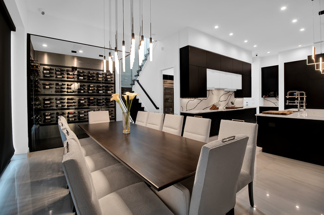
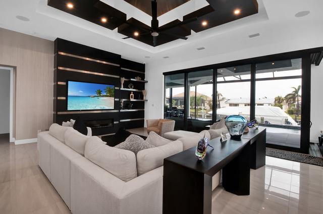
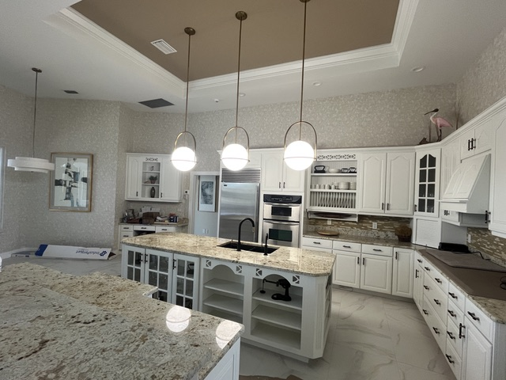
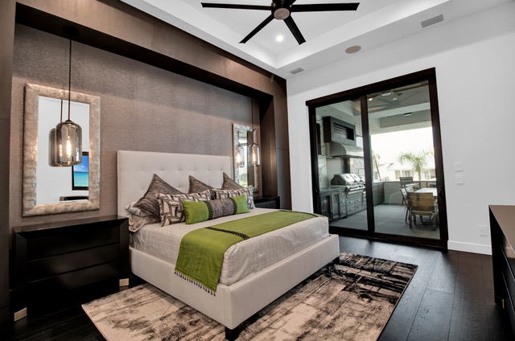
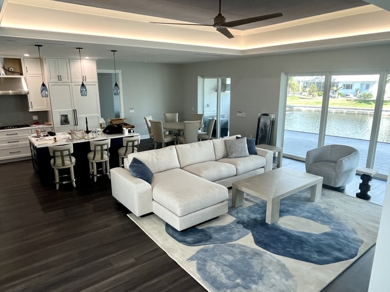
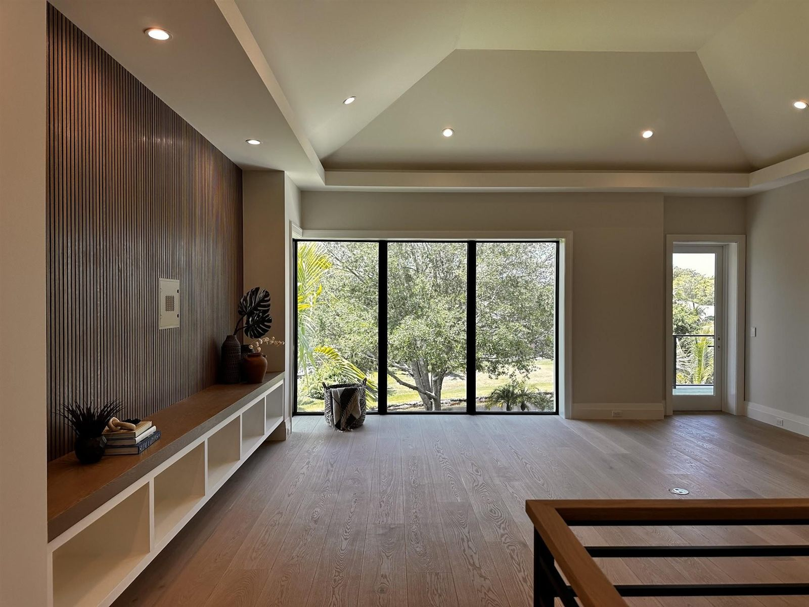
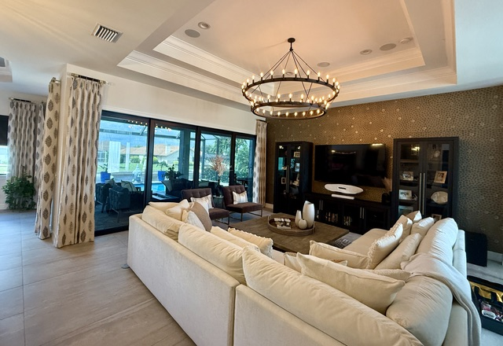
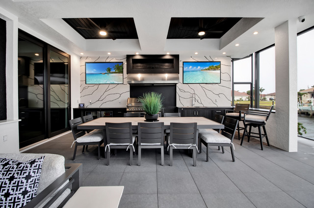
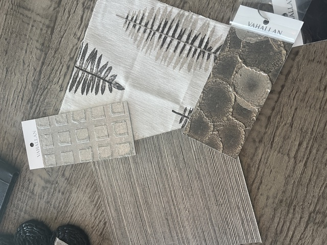

<section class="hero hero-logo">
    

      

        
        <h1>Punta Gorda Interior Design. Inspired by You.</h1>
        
An owner-led design studio in Charlotte Harbor, creating homes across Punta Gorda, Port Charlotte, Sarasota, and the Gulf Coast — from a single room to the whole house.

        

          <a class="btn btn-brass btn-lg" href="#consultation">Request a Free Consultation</a>
          <a class="btn btn-ghost btn-lg" href="tel:+19414564136">
            <svg viewBox="0 0 24 24" fill="none" stroke="currentColor" stroke-width="2" stroke-linecap="round" stroke-linejoin="round" aria-hidden="true"><path d="M22 16.92v3a2 2 0 0 1-2.18 2 19.79 19.79 0 0 1-8.63-3.07 19.5 19.5 0 0 1-6-6 19.79 19.79 0 0 1-3.07-8.67A2 2 0 0 1 4.11 2h3a2 2 0 0 1 2 1.72c.127.96.362 1.903.7 2.81a2 2 0 0 1-.45 2.11L8.09 9.91a16 16 0 0 0 6 6l1.27-1.27a2 2 0 0 1 2.11-.45c.907.338 1.85.573 2.81.7A2 2 0 0 1 22 16.92z"></path></svg>
            Call (941) 456-4136
          </a>
        

        <ul class="hero-trust">
          <li>Free Initial Consultation</li>
          <li>500+ Projects</li>
          <li>Owner-Led Studio</li>
          <li>Design &amp; Renovation</li>
        </ul>
      

    

  </section>
  <section class="work-carousel-section">
    

      

        

          
Recent Work

          <h2>See Our Work</h2>
        

        

          <button class="carousel-btn" type="button" data-carousel-prev="" aria-label="Previous project">
            <svg viewBox="0 0 24 24" fill="none" stroke="currentColor" stroke-width="1.5" stroke-linecap="round" stroke-linejoin="round" aria-hidden="true"><path d="M15 18l-6-6 6-6"></path></svg>
          </button>
          <button class="carousel-btn" type="button" data-carousel-next="" aria-label="Next project">
            <svg viewBox="0 0 24 24" fill="none" stroke="currentColor" stroke-width="1.5" stroke-linecap="round" stroke-linejoin="round" aria-hidden="true"><path d="M9 18l6-6-6-6"></path></svg>
          </button>
        

      

    

    

      <ul class="work-carousel" tabindex="0" aria-label="Recent work">
        <li class="work-card">
          

          
<h3>Dining &amp; Wine Wall</h3>
Full-Home Design

        </li>
        <li class="work-card">
          

          
<h3>Living Room Media Wall</h3>
Interior Design

        </li>
        <li class="work-card">
          

          
<h3>Kitchen Renovation</h3>
Kitchen &amp; Bath Design

        </li>
        <li class="work-card">
          

          
<h3>Primary Suite</h3>
Interior Design

        </li>
        <li class="work-card">
          

          
<h3>Waterfront Great Room</h3>
Space Planning

        </li>
        <li class="work-card">
          

          
<h3>Loft &amp; Slat Wall</h3>
New Construction Design

        </li>
        <li class="work-card">
          

          
<h3>Great Room Refresh</h3>
Color Consultation

        </li>
        <li class="work-card">
          

          
<h3>Outdoor Living</h3>
Interior Design

        </li>
      </ul>
      

        <a class="btn btn-primary" href="/portfolio">View the Full Portfolio</a>
        <a class="btn" href="/services">Explore Our Services</a>
      

    

  </section>
  <section class="section form-section band-sky" id="consultation">
    

      <form class="quote-form" name="consultation-request" method="POST" action="/thank-you" data-netlify="true" netlify-honeypot="bot-field" novalidate="">
        <input type="hidden" name="form-name" value="consultation-request">
        <input type="hidden" name="page" value="">
        <input type="hidden" name="first_page" value="">
        <input type="hidden" name="referrer" value="">
        
<label>Leave this field blank: <input name="bot-field" tabindex="-1" autocomplete="off"></label>

        
Free Consultation · $250 Value

        <h2 style="margin-bottom:1.25rem;">Request a Consultation</h2>
        
<small>Step 1 of 4</small>

        

          Your Name *
          <input type="text" name="name" aria-labelledby="qf-name-label" placeholder="Full Name" required="" autocomplete="name">
          How Can We Reach You? *
          
Phone or email — whichever you prefer.

          

            <input type="tel" name="phone" placeholder="Phone" autocomplete="tel" aria-label="Phone">
            <input type="email" name="email" placeholder="Email" autocomplete="email" aria-label="Email">
          

          <!-- SMS consent for Interior Motives Design's own 10DLC campaign: unchecked, optional, separate from any terms, names the business and the message types, links to the policy pages. Lands in the Netlify submission as sms_consent=yes. -->
          <label class="consent-row"><input type="checkbox" name="sms_consent" value="yes"> By providing my phone number and checking this box, I agree to receive SMS customer care messages from Interior Motives Design: callback confirmations, follow-ups on my request, appointment reminders and a review request after a completed project. Message frequency may vary. Standard message and data rates may apply. Reply STOP to opt out, HELP for help. We will not share mobile information with third parties for promotional or marketing purposes. Consent is not a condition of purchase. <a href="/privacy">Privacy Policy</a> and <a href="/terms">Terms</a>.</label>
          
Tell us who you are and a few more questions will appear.

        

        

          Where Is the Project?
          <select name="service-area" aria-labelledby="qf-area-label">
            <option value="" disabled="" selected="">City / Service Area</option>
            <option>Charlotte Harbor</option>
            <option>Punta Gorda</option>
            <option>Port Charlotte</option>
            <option>North Port</option>
            <option>Venice</option>
            <option>Sarasota</option>
            <option>Cape Coral</option>
            <option>Englewood</option>
            <option>Boca Grande</option>
            <option>Nokomis</option>
            <option>Other</option>
          </select>
          How Did You Hear About Us?
          <select name="heard_about" aria-label="How did you hear about us?">
            <option value="" selected="">Choose one (optional)</option>
            <option>Google search</option>
            <option>Google Maps / our Google listing</option>
            <option>Facebook</option>
            <option>Instagram</option>
            <option>A friend, family member or past client</option>
            <option>A builder, realtor or trade partner</option>
            <option>Saw our work in someone's home</option>
            <option>Other</option>
          </select>
          What Can We Help With?
          

            <label class="check-item"><input type="checkbox" name="service[]" value="Interior Design"> Interior Design</label>
            <label class="check-item"><input type="checkbox" name="service[]" value="Space Planning"> Space Planning</label>
            <label class="check-item"><input type="checkbox" name="service[]" value="Color Consultation"> Color Consultation</label>
            <label class="check-item"><input type="checkbox" name="service[]" value="Kitchen &amp; Bath Design"> Kitchen &amp; Bath Design</label>
            <label class="check-item"><input type="checkbox" name="service[]" value="New Construction Design"> New Construction Design</label>
            <label class="check-item"><input type="checkbox" name="service[]" value="Wallpaper &amp; Window Treatments"> Wallpaper &amp; Window Treatments</label>
            <label class="check-item"><input type="checkbox" name="service[]" value="Furniture &amp; Decor"> Furniture &amp; Decor</label>
            <label class="check-item"><input type="checkbox" name="service[]" value="Other"> Other</label>
          

          
Pick a city and at least one service to continue.

        

        

          When Would You Like to Start?
          

            <label class="radio-item"><input type="radio" name="timing" value="Timing is flexible"> Timing is Flexible</label>
            <label class="radio-item"><input type="radio" name="timing" value="Within 1 month"> Within 1 Month</label>
            <label class="radio-item"><input type="radio" name="timing" value="1 to 3 months"> 1–3 Months</label>
            <label class="radio-item"><input type="radio" name="timing" value="More than 3 months"> More Than 3 Months</label>
          

          Project Status
          

            <label class="radio-item"><input type="radio" name="status" value="Ready to book a consultation"> Ready to Book</label>
            <label class="radio-item"><input type="radio" name="status" value="Just exploring ideas"> Just Exploring Ideas</label>
          

          
Almost there — one last question.

        

        

          Tell Us About Your Project
          <textarea name="message" id="message" aria-labelledby="qf-message-label" placeholder="Rooms involved, the style you're drawn to, a rough budget range, anything else we should know."></textarea>
        

        <button type="submit" class="btn btn-primary btn-lg">Send My Request</button>
        
We'll only use your details to follow up about your project.

      </form>
      <aside class="form-aside">
        

          
Let's Chat

          <h2>Let's Get in Touch</h2>
          
Fill out the form or call us directly. Your initial consultation is complimentary — a $250 value — and it's the best way to find out whether we're the right fit for your home.

          <ul class="contact-list">
            <li>
              <svg viewBox="0 0 24 24" fill="none" stroke="currentColor" stroke-linecap="round" stroke-linejoin="round" aria-hidden="true"><path d="M22 16.92v3a2 2 0 0 1-2.18 2 19.79 19.79 0 0 1-8.63-3.07 19.5 19.5 0 0 1-6-6 19.79 19.79 0 0 1-3.07-8.67A2 2 0 0 1 4.11 2h3a2 2 0 0 1 2 1.72c.127.96.362 1.903.7 2.81a2 2 0 0 1-.45 2.11L8.09 9.91a16 16 0 0 0 6 6l1.27-1.27a2 2 0 0 1 2.11-.45c.907.338 1.85.573 2.81.7A2 2 0 0 1 22 16.92z"></path></svg>
              <a href="tel:+19414564136">(941) 456-4136</a><small>Lori · by appointment</small>
            </li>
            <li>
              <svg viewBox="0 0 24 24" fill="none" stroke="currentColor" stroke-linecap="round" stroke-linejoin="round" aria-hidden="true"><path d="M22 16.92v3a2 2 0 0 1-2.18 2 19.79 19.79 0 0 1-8.63-3.07 19.5 19.5 0 0 1-6-6 19.79 19.79 0 0 1-3.07-8.67A2 2 0 0 1 4.11 2h3a2 2 0 0 1 2 1.72c.127.96.362 1.903.7 2.81a2 2 0 0 1-.45 2.11L8.09 9.91a16 16 0 0 0 6 6l1.27-1.27a2 2 0 0 1 2.11-.45c.907.338 1.85.573 2.81.7A2 2 0 0 1 22 16.92z"></path></svg>
              <a href="tel:+17276382381">(727) 638-2381</a><small>Holly · by appointment</small>
            </li>
            <li>
              <svg viewBox="0 0 24 24" fill="none" stroke="currentColor" stroke-linecap="round" stroke-linejoin="round" aria-hidden="true"><path d="M22 6l-10 7L2 6"></path><rect x="2" y="4" width="20" height="16" rx="2"></rect></svg>
              <a href="mailto:Info@InteriorMotives1.com">Info@InteriorMotives1.com</a>
            </li>
            <li>
              <svg viewBox="0 0 24 24" fill="none" stroke="currentColor" stroke-linecap="round" stroke-linejoin="round" aria-hidden="true"><path d="M21 10c0 6-9 12-9 12s-9-6-9-12a9 9 0 0 1 18 0z"></path><circle cx="12" cy="10" r="3"></circle></svg>
              4288 Pinnacle St, Punta Gorda, FL 33980<small>Our Charlotte Harbor studio · serving Sarasota, Charlotte &amp; Lee Counties</small>
            </li>
          </ul>
        

        

          
        

      </aside>
      

        <a class="btn btn-primary" href="tel:+19414564136">Call (941) 456-4136</a>
        <a class="btn" href="/team">Meet the Team</a>
      

    

  </section>
  <section class="section band-white" id="reviews">
    

      

        
Google Reviews

        <h2>What Our Clients Say</h2>
        
Word for word, from our Google listing.

      

      

        <figure class="review-card">
          

            <svg viewBox="0 0 24 24" fill="currentColor" aria-hidden="true"><path d="M12 2l3.09 6.26L22 9.27l-5 4.87 1.18 6.88L12 17.77l-6.18 3.25L7 14.14 2 9.27l6.91-1.01L12 2z"></path></svg>
            <svg viewBox="0 0 24 24" fill="currentColor" aria-hidden="true"><path d="M12 2l3.09 6.26L22 9.27l-5 4.87 1.18 6.88L12 17.77l-6.18 3.25L7 14.14 2 9.27l6.91-1.01L12 2z"></path></svg>
            <svg viewBox="0 0 24 24" fill="currentColor" aria-hidden="true"><path d="M12 2l3.09 6.26L22 9.27l-5 4.87 1.18 6.88L12 17.77l-6.18 3.25L7 14.14 2 9.27l6.91-1.01L12 2z"></path></svg>
            <svg viewBox="0 0 24 24" fill="currentColor" aria-hidden="true"><path d="M12 2l3.09 6.26L22 9.27l-5 4.87 1.18 6.88L12 17.77l-6.18 3.25L7 14.14 2 9.27l6.91-1.01L12 2z"></path></svg>
            <svg viewBox="0 0 24 24" fill="currentColor" aria-hidden="true"><path d="M12 2l3.09 6.26L22 9.27l-5 4.87 1.18 6.88L12 17.77l-6.18 3.25L7 14.14 2 9.27l6.91-1.01L12 2z"></path></svg>
          

          <blockquote>Lori Brunderman helped us design a beautiful home in Punta Gorda.  Our house had the WOW factor times ten.  She has incredible talent, listens to what you are looking for and makes it happen.  Our house was modern but still had that homey feel.  Everyone who came to visit was blown away!</blockquote>
          <figcaption class="review-meta"><strong>William B.</strong>Google review · October 2026</figcaption>
        </figure>
        <figure class="review-card">
          

            <svg viewBox="0 0 24 24" fill="currentColor" aria-hidden="true"><path d="M12 2l3.09 6.26L22 9.27l-5 4.87 1.18 6.88L12 17.77l-6.18 3.25L7 14.14 2 9.27l6.91-1.01L12 2z"></path></svg>
            <svg viewBox="0 0 24 24" fill="currentColor" aria-hidden="true"><path d="M12 2l3.09 6.26L22 9.27l-5 4.87 1.18 6.88L12 17.77l-6.18 3.25L7 14.14 2 9.27l6.91-1.01L12 2z"></path></svg>
            <svg viewBox="0 0 24 24" fill="currentColor" aria-hidden="true"><path d="M12 2l3.09 6.26L22 9.27l-5 4.87 1.18 6.88L12 17.77l-6.18 3.25L7 14.14 2 9.27l6.91-1.01L12 2z"></path></svg>
            <svg viewBox="0 0 24 24" fill="currentColor" aria-hidden="true"><path d="M12 2l3.09 6.26L22 9.27l-5 4.87 1.18 6.88L12 17.77l-6.18 3.25L7 14.14 2 9.27l6.91-1.01L12 2z"></path></svg>
            <svg viewBox="0 0 24 24" fill="currentColor" aria-hidden="true"><path d="M12 2l3.09 6.26L22 9.27l-5 4.87 1.18 6.88L12 17.77l-6.18 3.25L7 14.14 2 9.27l6.91-1.01L12 2z"></path></svg>
          

          <blockquote>We hired Lori to help us with the past two homes we built. She is very knowledgeable, creative  and fun to work with. I took my ideas and inspirations to her and she helped facilitate my dreams into reality! She was awesome to work with!</blockquote>
          <figcaption class="review-meta"><strong>Rosi B.</strong>Google review · October 2026</figcaption>
        </figure>
      

      
<a class="text-link" href="https://g.page/r/CfIl01umbGmYEBM" target="_blank" rel="noopener">Read our reviews on Google</a> &middot; Worked with us? <a class="text-link" href="https://g.page/r/CfIl01umbGmYEBM/review" target="_blank" rel="noopener">Leave a Google review</a>

    

  </section>
  <section class="section band-cream" id="local">
    

      

        <h2>Interior Designers for Punta Gorda, Port Charlotte &amp; Charlotte Harbor</h2>
        
We're Interior Motives Design, an owner-led interior design and renovation studio in Charlotte Harbor, on the north shore of the Peace River across from downtown Punta Gorda. We, Holly and Lori, have spent more than 20 years designing Southwest Florida homes, with 500+ projects completed, from a single room to the whole house. Because one team handles both design and renovation, the people who draw your plan are the same people who see it through to the final install.

        
Most of our work is close to home: <a href="/locations/punta-gorda">Punta Gorda</a> homes from the historic downtown to Punta Gorda Isles, canal-front houses across the river in <a href="/locations/port-charlotte">Port Charlotte</a>, and newer builds in <a href="/locations/north-port">North Port</a>. We also design homes in <a href="/locations/englewood">Englewood</a>, <a href="/locations/boca-grande">Boca Grande</a>, <a href="/locations/venice">Venice</a> and <a href="/locations/sarasota">Sarasota</a>.

        <h3>How a project starts</h3>
        
Every project begins with an in-home consultation, and the initial consultation is free, a $250 value. From there we plan the layout, the color and the finishes, and present your selections as real samples laid out in our studio, not just mood boards. We have access to to-the-trade fabric and furniture lines sold only through designers, and we handle furniture ordering, receiving, delivery and placement. Start with <a href="/services/interior-design">full interior design</a>, <a href="/services/kitchen-bath-design">kitchen and bath design</a>, <a href="/services/new-construction-design">new construction design</a> or a <a href="/services/color-consultation">color consultation</a>, or see finished rooms in the <a href="/portfolio">portfolio</a>.

      

      

        <a class="btn btn-primary" href="tel:+19414564136">Call (941) 456-4136</a>
        <a class="btn" href="#consultation">Book a Design Consultation</a>
      

    

  </section>
