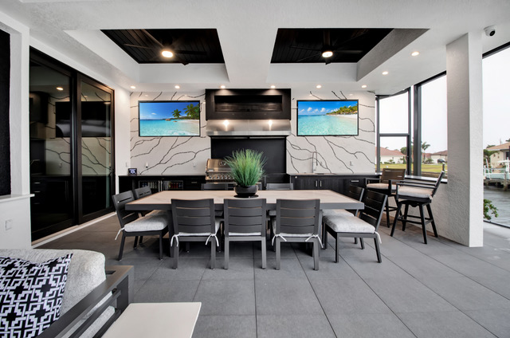

<section class="page-hero has-image">
    

      

      
<a href="/">Home</a> › Service Area

      
Service Area

      <h1>Interior Design Across Charlotte, Sarasota &amp; Lee Counties</h1>
      
From our studio in Charlotte Harbor, Punta Gorda, we design and renovate homes from Boca Grande to Sarasota, with Punta Gorda and Port Charlotte right on our doorstep.

    

      

    

  </section>
  <section class="section band-white">
    

      

        
We serve all of Charlotte, Sarasota and Lee Counties. These are the communities where most of our interior design work happens.

      

      

        <a class="card service-card" href="/locations/punta-gorda">
          <h3>Punta Gorda, FL</h3>
          
Our home base: the historic harbor-front downtown, Punta Gorda Isles canal homes and Burnt Store.

          View Area →
        </a>
        <a class="card service-card" href="/locations/port-charlotte">
          <h3>Port Charlotte, FL</h3>
          
Canal-front ranch homes from a classic mid-century planned community, just across the Peace River.

          View Area →
        </a>
        <a class="card service-card" href="/locations/north-port">
          <h3>North Port, FL</h3>
          
One of the region's fastest-growing cities, full of newer-construction homes.

          View Area →
        </a>
        <a class="card service-card" href="/locations/englewood">
          <h3>Englewood, FL</h3>
          
Manasota Key beach houses, Lemon Bay waterfront and Old Englewood cottages.

          View Area →
        </a>
        <a class="card service-card" href="/locations/boca-grande">
          <h3>Boca Grande, FL</h3>
          
Classic island homes and seasonal residences on Gasparilla Island.

          View Area →
        </a>
        <a class="card service-card" href="/locations/venice">
          <h3>Venice &amp; Nokomis, FL</h3>
          
Northern Italian Renaissance-planned streets, Venice Island homes and the Casey Key waterfront.

          View Area →
        </a>
        <a class="card service-card" href="/locations/sarasota">
          <h3>Sarasota, FL</h3>
          
Downtown condos, historic bungalows, and the Siesta Key arts &amp; beach lifestyle.

          View Area →
        </a>
      

    

  </section>
  <section class="section band-sky">
    

      

        <h2>Where Our Interior Designers Work</h2>
        
Our studio sits in Charlotte Harbor, on the north shore of the Peace River across from downtown Punta Gorda, so Punta Gorda, Port Charlotte and Charlotte Harbor homes are a short drive away. Every project starts with an in-home consultation, and your selections are presented as real samples laid out in our studio, not just mood boards.

        
We also take on interior design and renovation work in Cape Coral, Nokomis and the rest of Charlotte, Sarasota and Lee Counties. If your home is not on the list above, call us: the initial consultation is free, a $250 value, and it is the quickest way to find out whether we are the right fit.

      

    

  </section>
  <section class="section cta-band band-navy" id="cta">
    

      

        
Let's Talk About Your Space

        <h2>Don't See Your City?</h2>
        
Give us a call — we may still be able to help, even if it's just outside our listed service area.

      

      

        <a class="btn btn-primary" href="tel:+19414564136">
          <svg viewBox="0 0 24 24" fill="none" stroke="currentColor" stroke-width="2" stroke-linecap="round" stroke-linejoin="round" aria-hidden="true"><path d="M22 16.92v3a2 2 0 0 1-2.18 2 19.79 19.79 0 0 1-8.63-3.07 19.5 19.5 0 0 1-6-6 19.79 19.79 0 0 1-3.07-8.67A2 2 0 0 1 4.11 2h3a2 2 0 0 1 2 1.72c.127.96.362 1.903.7 2.81a2 2 0 0 1-.45 2.11L8.09 9.91a16 16 0 0 0 6 6l1.27-1.27a2 2 0 0 1 2.11-.45c.907.338 1.85.573 2.81.7A2 2 0 0 1 22 16.92z"></path></svg>
          Call (941) 456-4136
        </a>
        <a class="btn btn-ghost btn-lg" href="/contact#consultation">Request a Consultation</a>
      

    

  </section>
