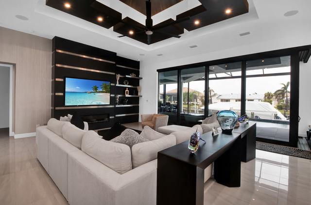
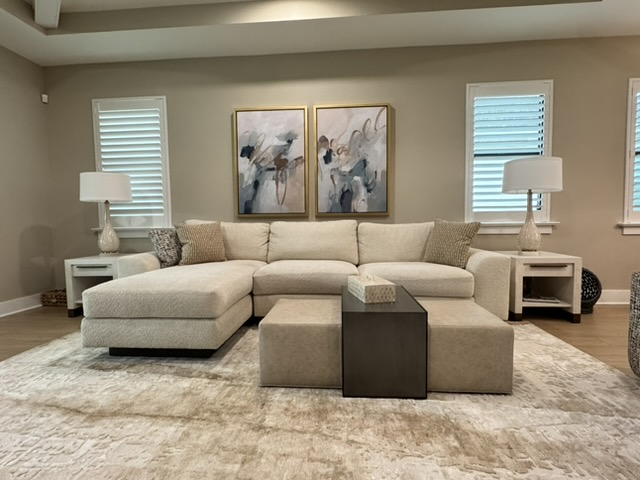

<section class="page-hero has-image">
    

      

      
<a href="/">Home</a> › <a href="/services">Services</a> › Interior Design

      
Service

      <h1>Interior Design in Punta Gorda &amp; Port Charlotte</h1>
      
Full-room and full-house design that turns your Southwest Florida home into a space that looks intentional, feels comfortable, and works for the way you actually live.

      

        <a class="btn btn-primary" href="tel:+19414564136">
          <svg viewBox="0 0 24 24" fill="none" stroke="currentColor" stroke-width="2" stroke-linecap="round" stroke-linejoin="round" aria-hidden="true"><path d="M22 16.92v3a2 2 0 0 1-2.18 2 19.79 19.79 0 0 1-8.63-3.07 19.5 19.5 0 0 1-6-6 19.79 19.79 0 0 1-3.07-8.67A2 2 0 0 1 4.11 2h3a2 2 0 0 1 2 1.72c.127.96.362 1.903.7 2.81a2 2 0 0 1-.45 2.11L8.09 9.91a16 16 0 0 0 6 6l1.27-1.27a2 2 0 0 1 2.11-.45c.907.338 1.85.573 2.81.7A2 2 0 0 1 22 16.92z"></path></svg>
          Call (941) 456-4136
        </a>
        <a class="btn" href="/contact#consultation">Request a Consultation</a>
      

      

      

    

  </section>
  <section class="section band-white">
    

      

        <h2>What's Included</h2>
        
Every interior design engagement is built around your home and your household, not a template. Depending on scope, that typically includes:

        <ul class="check-list">
          <li>
            <svg viewBox="0 0 24 24" fill="none" stroke="currentColor" stroke-width="2" stroke-linecap="round" stroke-linejoin="round" aria-hidden="true"><path d="M20 6L9 17l-5-5"></path></svg>
            In-home consultation to understand how you use your space and what isn't working
          </li>
          <li>
            <svg viewBox="0 0 24 24" fill="none" stroke="currentColor" stroke-width="2" stroke-linecap="round" stroke-linejoin="round" aria-hidden="true"><path d="M20 6L9 17l-5-5"></path></svg>
            Furniture layout and space planning for each room in scope
          </li>
          <li>
            <svg viewBox="0 0 24 24" fill="none" stroke="currentColor" stroke-width="2" stroke-linecap="round" stroke-linejoin="round" aria-hidden="true"><path d="M20 6L9 17l-5-5"></path></svg>
            Color, material, and finish selection tied to a cohesive whole-home palette
          </li>
          <li>
            <svg viewBox="0 0 24 24" fill="none" stroke="currentColor" stroke-width="2" stroke-linecap="round" stroke-linejoin="round" aria-hidden="true"><path d="M20 6L9 17l-5-5"></path></svg>
            Furnishings, lighting, and decor sourcing recommendations
          </li>
          <li>
            <svg viewBox="0 0 24 24" fill="none" stroke="currentColor" stroke-width="2" stroke-linecap="round" stroke-linejoin="round" aria-hidden="true"><path d="M20 6L9 17l-5-5"></path></svg>
            Coordination with our renovation team if the design calls for construction work
          </li>
        </ul>
        <h2 style="margin-top:3rem;">How It Works</h2>
        <ol class="process-steps" style="margin-top:1.5rem;">
          <li>
            
<h3>Consultation</h3>
We walk your space together and talk through goals, style, and budget.

          </li>
          <li>
            
<h3>Design Plan</h3>
We put together layouts, palettes, and selections for your review.

          </li>
          <li>
            
<h3>Refine</h3>
We adjust the plan with your feedback until it's exactly right.

          </li>
          <li>
            
<h3>Bring It to Life</h3>
We source, coordinate, and — if needed — renovate to make it real.

          </li>
        </ol>
      

      <aside class="sidebar-card">
        

        

          <h3>Ready to Redesign Your Space?</h3>
          
Call us or send a quick note — the initial consultation is complimentary.

          

            <a class="btn btn-primary" href="tel:+19414564136" style="justify-content:center;">Call (941) 456-4136</a>
            <a class="btn" href="/contact#consultation">Request a Consultation</a>
          

        

        

          <h4 style="font-family:var(--font-accent); text-transform:uppercase; font-size:0.8rem; letter-spacing:0.08em; margin-bottom:0.5rem;">Related Services</h4>
          <a href="/services/space-planning">Space Planning</a>
          <a href="/services/color-consultation">Color Consultation</a>
          <a href="/services/kitchen-bath-design">Kitchen &amp; Bath Design</a>
          <a href="/services/new-construction-design">New Construction Design</a>
        

      </aside>
    

  </section>
  <section class="section band-sky">
    

      

        
Where We Work

        <h2>Interior Design Across Southwest Florida</h2>
        
We take on interior design projects throughout the Gulf Coast, including:

      

      

        <a class="btn" style="justify-content:center;" href="/locations/sarasota">Sarasota</a>
        <a class="btn" style="justify-content:center;" href="/locations/venice">Venice</a>
        <a class="btn" style="justify-content:center;" href="/locations/north-port">North Port</a>
        <a class="btn" style="justify-content:center;" href="/locations/port-charlotte">Port Charlotte</a>
        <a class="btn" style="justify-content:center;" href="/locations/punta-gorda">Punta Gorda</a>
        <a class="btn" style="justify-content:center;" href="/locations/englewood">Englewood</a>
        <a class="btn" style="justify-content:center;" href="/locations/boca-grande">Boca Grande</a>
        <a class="btn btn-secondary" style="justify-content:center;" href="/locations">View All Areas</a>
      

    

  </section>
  <section class="section band-white">
    

      

        <h2>Interior Design for Punta Gorda, Port Charlotte &amp; Charlotte Harbor Homes</h2>
        
Our interior design studio is in Charlotte Harbor, on the north shore of the Peace River across from downtown Punta Gorda, so most of our clients live a short drive away in <a href="/locations/punta-gorda">Punta Gorda</a>, <a href="/locations/port-charlotte">Port Charlotte</a>, Charlotte Harbor and <a href="/locations/north-port">North Port</a>. We are Holly and Lori, and we have designed Southwest Florida homes for more than 20 years, with 500+ projects completed. We still lead every project ourselves.

        
Designing a home here is different from designing one up north. Afternoon sun pours through big sliders and fades fabrics and rugs; humidity and salt air near the harbor change how wood, metal and natural fibers age; and most homes have tile floors and an open great room that runs straight out to the lanai or the pool. Good interior design in Punta Gorda and Port Charlotte plans for all of that, so the room still looks right in August and in ten years.

        
Many of our clients also own a seasonal home or are building a new one. Because we handle furniture ordering, receiving, delivery and placement, a home can be furnished and finished before you arrive for the season, and new builds can be planned with the builder from the first selections. Read our guides to <a href="/blog/furnish-florida-condo-before-season">furnishing a Florida condo before season</a> and <a href="/blog/new-construction-home-design-decisions-early">what to decide early in a new build</a>.

        <h2>Why Homeowners Choose Interior Motives Design</h2>
        <ul>
          <li>An owner-led studio: the two of us, Holly and Lori, design your home ourselves</li>
          <li>20+ years designing Southwest Florida homes and 500+ projects completed</li>
          <li>One team for design and renovation, from first layout to final install</li>
          <li>Every project starts with an in-home consultation, and the initial consultation is free, a $250 value</li>
          <li>Selections presented as real samples laid out in our studio, not just mood boards</li>
          <li>Access to to-the-trade fabric and furniture lines sold only through designers</li>
          <li>Furniture ordering, receiving, delivery and placement handled for you</li>
        </ul>
        
Want to see the work first? Browse the <a href="/portfolio">portfolio</a>, read what <a href="/#reviews">our clients say on Google</a>, or <a href="/team">meet the team</a>.

        <h2>Frequently Asked Questions</h2>
        

          

            
Is the first consultation really free?

            
Yes. The initial consultation is complimentary, a $250 value. It is the easiest way to find out whether we are the right fit for your home before you commit to anything.

          

          

            
Do you only design, or do you renovate as well?

            
Both. One team handles design and renovation, from the first layout to the final install, so your plan never has to be handed from a designer to a separate firm.

          

          

            
Where is your studio?

            
Our studio is in Charlotte Harbor, just across the Peace River from downtown Punta Gorda. Studio visits are by appointment, and every project starts with a consultation in your home.

          

          

            
Which areas do you serve?

            
Charlotte, Sarasota and Lee Counties. Most of our work is in Punta Gorda, Port Charlotte, Charlotte Harbor and North Port, and we also design homes in Englewood, Boca Grande, Venice, Nokomis, Sarasota and Cape Coral.

          

          

            
Can you work with furniture we already own?

            
Yes. We plan around the pieces worth keeping, and our upholstery service can give a favorite sofa or chair new fabric so it belongs in the new room.

          

        

        <h2>Looking for an Interior Designer Near You?</h2>
        
If you are searching for an interior designer near Punta Gorda, Port Charlotte or Charlotte Harbor, we are local, and we design whole homes as well as single rooms. A full-home project might cover the layout, color palette, finishes, furniture, lighting, window treatments, rugs and art; a smaller one might be a living room refresh or a primary suite that finally feels finished.

        
Either way, the work starts the same way: a conversation in your home about how you live, what is not working, and the style you are drawn to. From there we put together layouts, palettes and selections for your review, refine them with you, and then source, coordinate and, where the design calls for it, renovate to make the plan real.

        <h3>Interior design services we offer</h3>
        <ul>
          <li>Whole-home interior design and single-room redesigns</li>
          <li><a href="/services/space-planning">Space planning and furniture layouts</a></li>
          <li><a href="/services/color-consultation">Color and finish selection</a></li>
          <li><a href="/services/kitchen-bath-design">Kitchen and bath design</a> and <a href="/services/new-construction-design">new construction design</a></li>
          <li><a href="/services/custom-fabrics">Custom fabrics</a>, <a href="/services/window-treatments">drapery</a> and <a href="/services/upholstery-bedding">upholstery</a></li>
          <li><a href="/services/lighting-selection">Lighting</a>, <a href="/services/rugs-fabrics">rugs</a>, <a href="/services/wallcoverings">wallpaper</a> and <a href="/services/art-accessories">art and styling</a></li>
        </ul>
        <h3>Where we design homes</h3>
        
We work across Charlotte, Sarasota and Lee Counties: <a href="/locations/punta-gorda">Punta Gorda</a>, <a href="/locations/port-charlotte">Port Charlotte</a>, Charlotte Harbor, <a href="/locations/north-port">North Port</a>, <a href="/locations/englewood">Englewood</a>, <a href="/locations/boca-grande">Boca Grande</a>, <a href="/locations/venice">Venice and Nokomis</a>, <a href="/locations/sarasota">Sarasota</a> and Cape Coral.

      

    

  </section>
  <section class="section cta-band band-navy" id="cta">
    

      

        
Let's Talk About Your Space

        <h2>Ready to Start Your Design?</h2>
        
Call the studio, or send a quick note and we'll get back to you — either way, the first consultation is free.

      

      

        <a class="btn btn-primary" href="tel:+19414564136">
          <svg viewBox="0 0 24 24" fill="none" stroke="currentColor" stroke-width="2" stroke-linecap="round" stroke-linejoin="round" aria-hidden="true"><path d="M22 16.92v3a2 2 0 0 1-2.18 2 19.79 19.79 0 0 1-8.63-3.07 19.5 19.5 0 0 1-6-6 19.79 19.79 0 0 1-3.07-8.67A2 2 0 0 1 4.11 2h3a2 2 0 0 1 2 1.72c.127.96.362 1.903.7 2.81a2 2 0 0 1-.45 2.11L8.09 9.91a16 16 0 0 0 6 6l1.27-1.27a2 2 0 0 1 2.11-.45c.907.338 1.85.573 2.81.7A2 2 0 0 1 22 16.92z"></path></svg>
          Call (941) 456-4136
        </a>
        <a class="btn btn-ghost btn-lg" href="/contact#consultation">Request a Consultation</a>
      

    

  </section>
