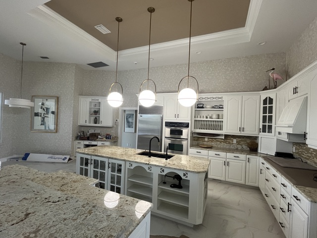
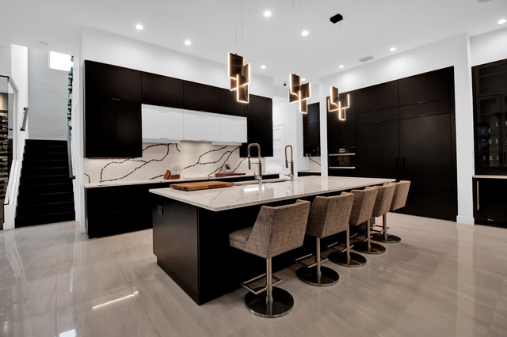

<section class="page-hero has-image">
    

      

      
<a href="/">Home</a> › <a href="/services">Services</a> › Kitchen &amp; Bath Design

      
Service

      <h1>Kitchen &amp; Bath Design in Punta Gorda &amp; Port Charlotte</h1>
      
Layout, cabinetry, and finish planning for the two rooms that matter most to daily life and resale value — done right the first time.

      

        <a class="btn btn-primary" href="tel:+19414564136">
          <svg viewBox="0 0 24 24" fill="none" stroke="currentColor" stroke-width="2" stroke-linecap="round" stroke-linejoin="round" aria-hidden="true"><path d="M22 16.92v3a2 2 0 0 1-2.18 2 19.79 19.79 0 0 1-8.63-3.07 19.5 19.5 0 0 1-6-6 19.79 19.79 0 0 1-3.07-8.67A2 2 0 0 1 4.11 2h3a2 2 0 0 1 2 1.72c.127.96.362 1.903.7 2.81a2 2 0 0 1-.45 2.11L8.09 9.91a16 16 0 0 0 6 6l1.27-1.27a2 2 0 0 1 2.11-.45c.907.338 1.85.573 2.81.7A2 2 0 0 1 22 16.92z"></path></svg>
          Call (941) 456-4136
        </a>
        <a class="btn" href="/contact#consultation">Request a Consultation</a>
      

      

      

    

  </section>
  <section class="section band-white">
    

      

        <h2>What's Included</h2>
        
Kitchens and bathrooms carry the most plumbing, electrical, and cabinetry decisions of any room in the house — getting the design right up front avoids expensive changes later. Depending on scope, that typically includes:

        <ul class="check-list">
          <li>
            <svg viewBox="0 0 24 24" fill="none" stroke="currentColor" stroke-width="2" stroke-linecap="round" stroke-linejoin="round" aria-hidden="true"><path d="M20 6L9 17l-5-5"></path></svg>
            Layout planning for cabinetry, counters, appliances, and fixtures
          </li>
          <li>
            <svg viewBox="0 0 24 24" fill="none" stroke="currentColor" stroke-width="2" stroke-linecap="round" stroke-linejoin="round" aria-hidden="true"><path d="M20 6L9 17l-5-5"></path></svg>
            Cabinetry style, finish, and hardware selection
          </li>
          <li>
            <svg viewBox="0 0 24 24" fill="none" stroke="currentColor" stroke-width="2" stroke-linecap="round" stroke-linejoin="round" aria-hidden="true"><path d="M20 6L9 17l-5-5"></path></svg>
            Countertop, tile, and fixture selection
          </li>
          <li>
            <svg viewBox="0 0 24 24" fill="none" stroke="currentColor" stroke-width="2" stroke-linecap="round" stroke-linejoin="round" aria-hidden="true"><path d="M20 6L9 17l-5-5"></path></svg>
            Coordination with plumbing and electrical needs
          </li>
          <li>
            <svg viewBox="0 0 24 24" fill="none" stroke="currentColor" stroke-width="2" stroke-linecap="round" stroke-linejoin="round" aria-hidden="true"><path d="M20 6L9 17l-5-5"></path></svg>
            Full renovation coordination through our construction team
          </li>
        </ul>
        <h2 style="margin-top:3rem;">How It Works</h2>
        <ol class="process-steps" style="margin-top:1.5rem;">
          <li>
<h3>Consultation</h3>
We walk your kitchen or bath together and talk through goals and budget.

</li>
          <li>
<h3>Design Plan</h3>
We put together layouts, cabinetry, and finish selections for your review.

</li>
          <li>
<h3>Refine</h3>
We adjust the plan with your feedback until it's exactly right.

</li>
          <li>
<h3>Renovate</h3>
Our team builds it — demo, construction, and installation, start to finish.

</li>
        </ol>
      

      <aside class="sidebar-card">
        

        

          <h3>Ready to Redo Your Kitchen or Bath?</h3>
          
Call us or send a quick note — the initial consultation is complimentary.

          

            <a class="btn btn-primary" href="tel:+19414564136" style="justify-content:center;">Call (941) 456-4136</a>
            <a class="btn" href="/contact#consultation">Request a Consultation</a>
          

        

        

          <h4 style="font-family:var(--font-accent); text-transform:uppercase; font-size:0.8rem; letter-spacing:0.08em; margin-bottom:0.5rem;">Related Services</h4>
          <a href="/services/interior-design">Interior Design</a>
          <a href="/services/space-planning">Space Planning</a>
          <a href="/services/color-consultation">Color Consultation</a>
          <a href="/services/new-construction-design">New Construction Design</a>
        

      </aside>
    

  </section>
  <section class="section band-sky">
    

      

        
Where We Work

        <h2>Kitchen &amp; Bath Design Across Southwest Florida</h2>
        
We take on kitchen and bath projects throughout the Gulf Coast, including:

      

      

        <a class="btn" style="justify-content:center;" href="/locations/sarasota">Sarasota</a>
        <a class="btn" style="justify-content:center;" href="/locations/venice">Venice</a>
        <a class="btn" style="justify-content:center;" href="/locations/north-port">North Port</a>
        <a class="btn" style="justify-content:center;" href="/locations/port-charlotte">Port Charlotte</a>
        <a class="btn" style="justify-content:center;" href="/locations/punta-gorda">Punta Gorda</a>
        <a class="btn" style="justify-content:center;" href="/locations/englewood">Englewood</a>
        <a class="btn" style="justify-content:center;" href="/locations/boca-grande">Boca Grande</a>
        <a class="btn btn-secondary" style="justify-content:center;" href="/locations">View All Areas</a>
      

    

  </section>
  <section class="section band-white">
    

      

        <h2>Kitchen &amp; Bath Design in Punta Gorda &amp; Port Charlotte</h2>
        
Many Port Charlotte homes still have the closed kitchen and small baths they were built with, and opening up the kitchen to the living area is one of the most common requests we hear. In Punta Gorda Isles and newer communities the kitchen usually already faces the great room and the lanai, so the work is about the island, storage, lighting and finishes that hold up to daily life and humidity.

        
Bathrooms here work hard too: walk-in showers, surfaces that cope with moisture, and good light for getting ready. Because one team handles design and renovation, the layout, cabinetry and finish plan go straight into the build, with no hand-off between a designer and a separate firm.

        <h2>Kitchen &amp; Bath Design Questions</h2>
        

          

            
Do you handle the renovation, or only the design?

            
Both. One team designs your kitchen or bath and handles the renovation, from the first layout to the final install.

          

          

            
Can you help choose cabinets, countertops and tile?

            
Yes. We plan the cabinetry layout and select the finishes, countertops, tile and fixtures, and you see the real samples laid out in our studio before anything is ordered.

          

          

            
Do you design bathrooms as well as kitchens?

            
Yes: primary baths, guest baths and powder rooms, including walk-in showers and vanities.

          

        

        <h3>Kitchen and bath services</h3>
        <ul>
          <li>Kitchen remodel design and layout</li>
          <li>Bathroom and primary bath remodel design</li>
          <li>Walk-in shower and vanity planning</li>
          <li>Cabinetry layout, door styles and finishes</li>
          <li>Countertop, tile and backsplash selection</li>
          <li>Lighting and plumbing fixture selection</li>
        </ul>
        <h3>Where we design kitchens and baths</h3>
        
We design and renovate kitchens and bathrooms in <a href="/locations/punta-gorda">Punta Gorda</a>, <a href="/locations/port-charlotte">Port Charlotte</a>, Charlotte Harbor and <a href="/locations/north-port">North Port</a>, and in homes across Charlotte, Sarasota and Lee Counties.

      

    

  </section>
  <section class="section cta-band band-navy" id="cta">
    

      

        
Let's Talk About Your Space

        <h2>Ready to Start Your Kitchen or Bath?</h2>
        
Call the studio, or send a quick note and we'll get back to you — either way, the first consultation is free.

      

      

        <a class="btn btn-primary" href="tel:+19414564136">
          <svg viewBox="0 0 24 24" fill="none" stroke="currentColor" stroke-width="2" stroke-linecap="round" stroke-linejoin="round" aria-hidden="true"><path d="M22 16.92v3a2 2 0 0 1-2.18 2 19.79 19.79 0 0 1-8.63-3.07 19.5 19.5 0 0 1-6-6 19.79 19.79 0 0 1-3.07-8.67A2 2 0 0 1 4.11 2h3a2 2 0 0 1 2 1.72c.127.96.362 1.903.7 2.81a2 2 0 0 1-.45 2.11L8.09 9.91a16 16 0 0 0 6 6l1.27-1.27a2 2 0 0 1 2.11-.45c.907.338 1.85.573 2.81.7A2 2 0 0 1 22 16.92z"></path></svg>
          Call (941) 456-4136
        </a>
        <a class="btn btn-ghost btn-lg" href="/contact#consultation">Request a Consultation</a>
      

    

  </section>
