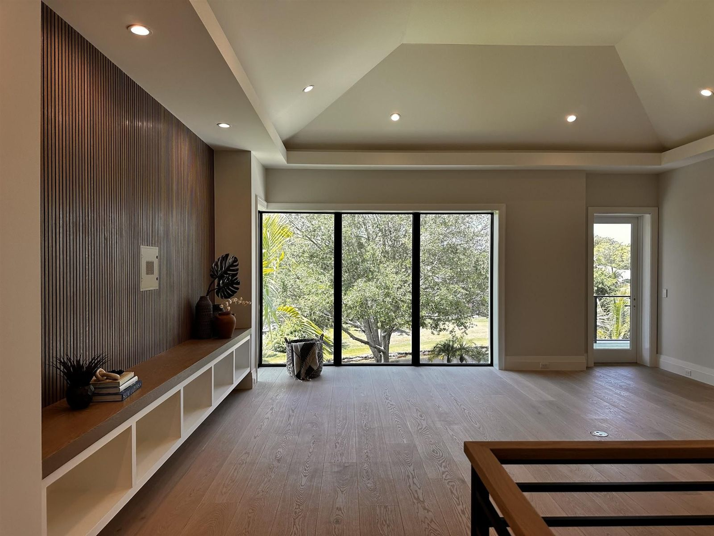
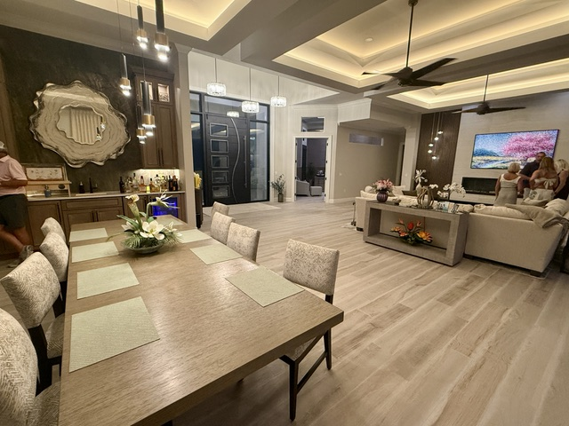

<section class="page-hero has-image">
    

      

        
<a href="/">Home</a> › <a href="/services">Services</a> › New Construction Design

        
Service

        <h1>New Construction Interior Design in Southwest Florida</h1>
        
Interior design for homes that haven't been built yet. We work alongside your builder on layouts, finishes, lighting, and furnishings so the design decisions are made early — before they become change orders.

        

          <a class="btn btn-primary" href="/contact">Request a Consultation</a>
          <a class="btn" href="tel:+19414771313">Call (941) 477-1313</a>
        

      

      

        
      

    

  </section>
  <section class="section band-white">
    

      

        <h2>What's Included</h2>
        
Building a new home means dozens of design decisions long before the first wall goes up. Depending on scope, that typically includes:

        <ul class="check-list">
          <li><svg viewBox="0 0 24 24" fill="none" stroke="currentColor" stroke-width="1.5" stroke-linecap="round" stroke-linejoin="round" aria-hidden="true"><path d="M20 6L9 17l-5-5"></path></svg>Plan review and furniture layouts for every room, so the spaces work before they're framed</li>
          <li><svg viewBox="0 0 24 24" fill="none" stroke="currentColor" stroke-width="1.5" stroke-linecap="round" stroke-linejoin="round" aria-hidden="true"><path d="M20 6L9 17l-5-5"></path></svg>Whole-home finish palette — flooring, cabinetry, countertops, tile, paint, and hardware</li>
          <li><svg viewBox="0 0 24 24" fill="none" stroke="currentColor" stroke-width="1.5" stroke-linecap="round" stroke-linejoin="round" aria-hidden="true"><path d="M20 6L9 17l-5-5"></path></svg>Lighting and electrical placement coordinated with your furniture plan</li>
          <li><svg viewBox="0 0 24 24" fill="none" stroke="currentColor" stroke-width="1.5" stroke-linecap="round" stroke-linejoin="round" aria-hidden="true"><path d="M20 6L9 17l-5-5"></path></svg>Feature walls, ceiling details, and built-ins designed with your builder's trades</li>
          <li><svg viewBox="0 0 24 24" fill="none" stroke="currentColor" stroke-width="1.5" stroke-linecap="round" stroke-linejoin="round" aria-hidden="true"><path d="M20 6L9 17l-5-5"></path></svg>Furnishings and decor ordered, received, delivered and placed for move-in day, with window treatments coordinated alongside</li>
        </ul>
        <h2 style="margin-top:3rem;">How It Works</h2>
        <ol class="process-steps" style="margin-top:1.5rem;">
          <li>
<h3>Consultation</h3>
We talk through your plans, lot, goals, and budget for the new home.

</li>
          <li>
<h3>Design Plan</h3>
We design the interiors — layouts, finishes, and lighting — for your review.

</li>
          <li>
<h3>Coordinate</h3>
We hand your builder a clear selection package and stay available through construction.

</li>
          <li>
<h3>Furnish &amp; Place</h3>
Furnishings and decor are ordered, received, delivered and placed as the home is finished.

</li>
        </ol>
      

      <aside class="sidebar-card">
        

        

          <h3>Building a New Home?</h3>
          
The earlier we're involved, the more we can save you in change orders. The initial consultation is complimentary.

          

            <a class="btn btn-primary" href="tel:+19414771313">Call (941) 477-1313</a>
            <a class="btn" href="/contact">Request a Consultation</a>
          

        

        

          <h4 style="font-family:var(--font-accent); text-transform:uppercase; font-size:0.72rem; letter-spacing:0.16em; margin-bottom:0.5rem;">Related Services</h4>
          <a href="/services/interior-design">Interior Design</a>
          <a href="/services/space-planning">Space Planning</a>
          <a href="/services/color-consultation">Color Consultation</a>
          <a href="/services/kitchen-bath-design">Kitchen &amp; Bath Design</a>
        

      </aside>
    

  </section>
  <section class="section band-sky">
    

      

        
Where We Work

        <h2>New Construction Design Across Southwest Florida</h2>
        
We take on new-build design projects throughout the Gulf Coast, including:

      

      

        <a class="btn" href="/locations/sarasota">Sarasota</a>
        <a class="btn" href="/locations/venice">Venice</a>
        <a class="btn" href="/locations/north-port">North Port</a>
        <a class="btn" href="/locations/port-charlotte">Port Charlotte</a>
        <a class="btn" href="/locations/punta-gorda">Punta Gorda</a>
        <a class="btn" href="/locations/englewood">Englewood</a>
        <a class="btn" href="/locations/boca-grande">Boca Grande</a>
        <a class="btn btn-primary" href="/locations">View All Areas</a>
      

    

  </section>
  <section class="section band-white">
    

      

        <h2>New Construction Design for Punta Gorda, North Port &amp; Southwest Florida</h2>
        
New homes keep going up around Charlotte Harbor, from the Burnt Store area south of Punta Gorda to the newer neighborhoods of <a href="/locations/north-port">North Port</a> and <a href="/locations/port-charlotte">Port Charlotte</a>. Builders usually present selections one category at a time, and it is easy to lock in flooring, cabinets and lighting that each look fine but do not work together. Bringing in an interior designer early keeps those decisions connected.

        
We work alongside your builder on layouts, finishes, lighting and furnishings, and when construction wraps up, we handle furniture ordering, receiving, delivery and placement so the house is ready to live in. Our guide to <a href="/blog/new-construction-home-design-decisions-early">what to decide early in a new build</a> walks through the order of decisions.

        <h3>New construction design services</h3>
        <ul>
          <li>Builder selection appointments: flooring, cabinets, counters and tile</li>
          <li>Lighting and outlet placement planning before drywall</li>
          <li>A whole-home color and finish palette</li>
          <li>Window treatment planning for new windows and sliders</li>
          <li>Furniture plans, ordering and placement for move-in</li>
          <li>Seasonal and second-home setups</li>
        </ul>
        <h3>Where we design new builds</h3>
        
We design new-construction homes in <a href="/locations/punta-gorda">Punta Gorda</a>, <a href="/locations/north-port">North Port</a>, <a href="/locations/port-charlotte">Port Charlotte</a>, Charlotte Harbor, <a href="/locations/englewood">Englewood</a> and <a href="/locations/venice">Venice and Nokomis</a>, and across Charlotte, Sarasota and Lee Counties.

      

    

  </section>
  <section class="section cta-band band-navy" id="cta">
    

      

        
Let's Talk About Your New Home

        <h2>Ready to Start Your Design?</h2>
        
Call the studio, or send a quick note and we'll get back to you — either way, the first consultation is free.

      

      

        <a class="btn btn-brass btn-lg" href="tel:+19414771313">
          <svg viewBox="0 0 24 24" fill="none" stroke="currentColor" stroke-width="2" stroke-linecap="round" stroke-linejoin="round" aria-hidden="true"><path d="M22 16.92v3a2 2 0 0 1-2.18 2 19.79 19.79 0 0 1-8.63-3.07 19.5 19.5 0 0 1-6-6 19.79 19.79 0 0 1-3.07-8.67A2 2 0 0 1 4.11 2h3a2 2 0 0 1 2 1.72c.127.96.362 1.903.7 2.81a2 2 0 0 1-.45 2.11L8.09 9.91a16 16 0 0 0 6 6l1.27-1.27a2 2 0 0 1 2.11-.45c.907.338 1.85.573 2.81.7A2 2 0 0 1 22 16.92z"></path></svg>
          Call (941) 477-1313
        </a>
        <a class="btn btn-ghost btn-lg" href="/contact#consultation">Request a Consultation</a>
      

    

  </section>
